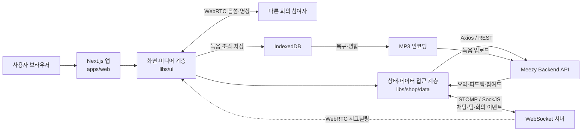

# Meezy

> 팀의 대화와 회의를 기록하고, AI 요약·피드백·참여도 분석으로 다음 협업을 더 나아지게 만드는 실시간 협업 서비스

[배포 서비스](https://meezy-fe.vercel.app) · [프론트엔드 저장소](https://github.com/team-Meezy/Meezy-FE) · [백엔드 저장소](https://github.com/team-Meezy/Meezy-BE)

## 서비스 소개

Meezy는 팀 채팅과 화상 회의를 한곳에서 제공하고, 회의가 끝난 뒤 녹음 데이터를 바탕으로 요약과 피드백을 확인할 수 있는 AI 회의 도우미입니다. 팀 생성·초대부터 실시간 채팅, WebRTC 회의, 녹음 복구, 참여도 시각화까지 협업 흐름 전체를 연결했습니다.

### 주요 기능

- 로컬 계정 및 Google·Kakao·Naver OAuth 로그인
- 초대 코드 기반 팀 생성·가입과 팀원 관리
- STOMP/SockJS 기반 실시간 채팅, 알림, Optimistic UI
- WebRTC 기반 화상 회의와 마이크·카메라·발화 상태 동기화
- 회의 녹음의 MP3 변환·업로드와 새로고침 후 녹음 복구
- 회의별 AI 요약·피드백 조회와 개인·팀 참여도 시각화

## 담당 역할과 팀 구성

| 구성원 | 역할 | 담당 범위 |
| --- | --- | --- |
| [정명우 (`@tccmw`)](https://github.com/tccmw) | Frontend | 프론트엔드 설계 및 구현 전반: 인증, 팀 관리, 채팅, WebRTC 회의, 녹음, AI 결과 화면, 반응형 UI, 배포 안정화 |
| [`@hyohyeon08`](https://github.com/hyohyeon08) | Backend | 인증·팀·채팅·회의 도메인의 REST API와 실시간 통신 서버 구현 |

프론트엔드는 정명우가 단독으로 담당했으며, Nx 모노레포 구조 설계부터 화면 구현, API 연동, 실시간 미디어 처리와 운영 이슈 대응까지 전체 흐름을 개발했습니다.

## 기술 스택과 선정 이유

| 구분 | 기술 | 선정 이유 |
| --- | --- | --- |
| 프레임워크 | Next.js 16, React 19, TypeScript | App Router의 파일 기반 라우팅과 레이아웃을 사용하고, TypeScript로 복잡한 회의·채팅 상태의 계약을 명확하게 관리하기 위해 선택했습니다. |
| 모노레포 | Nx 22 | 애플리케이션, 공용 UI, 데이터 접근 계층을 독립 프로젝트로 분리하고 의존성 그래프·캐시·통합 명령으로 일관되게 관리하기 위해 사용했습니다. |
| 상태 관리 | Zustand | 채팅 메시지, 회의 상태, 팀 정보처럼 여러 화면과 실시간 이벤트가 공유하는 상태를 적은 보일러플레이트로 관리하기 위해 선택했습니다. |
| HTTP 통신 | Axios | 인증 헤더 주입과 401 응답 시 토큰 재발급·원요청 재시도를 인터셉터 한곳에서 처리하기 위해 사용했습니다. |
| 실시간 통신 | STOMP, SockJS | 채팅·팀·회의 이벤트를 주제별로 구독하고, 연결 복구와 재구독을 일관된 방식으로 처리하기 위해 선택했습니다. |
| 화상 회의 | WebRTC, MediaDevices API | 브라우저 간 저지연 음성·영상 전송과 마이크·카메라 제어를 별도 플러그인 없이 구현하기 위해 사용했습니다. |
| 녹음 | MediaRecorder, Web Audio API, IndexedDB, lamejs | 회의 음성을 클라이언트에서 수집·MP3 변환하고, 녹음 조각을 로컬에 보존해 새로고침에도 복구하기 위해 조합했습니다. |
| UI | Tailwind CSS, 공용 디자인 토큰 | 빠른 화면 구성과 함께 색상·타이포그래피를 공용 UI 라이브러리에서 일관되게 재사용하기 위해 사용했습니다. |
| 품질 관리 | ESLint, Vitest, Playwright | 정적 검사, 단위 테스트, 브라우저 E2E 테스트를 Nx 작업으로 통합하기 위해 사용했습니다. |

## 아키텍처와 데이터 흐름



### 주요 프로젝트 구조

```text
apps/web/                 # 실제 서비스용 Next.js 애플리케이션과 라우트
libs/ui/                  # 페이지, 공용 컴포넌트, WebRTC·녹음 훅, 디자인 토큰
libs/shop/data/           # Axios, Zustand 스토어, 인증·팀·채팅·회의 API/소켓 훅
libs/shared/models/       # 공용 타입 모델
apps/shop-e2e/            # Playwright E2E 테스트
```

## 주요 문제와 해결 방법

### 1. 서버 응답 전까지 채팅 메시지가 보이지 않는 문제

기존에는 STOMP 응답이 돌아온 뒤에만 메시지를 화면에 추가해 네트워크 상태에 따라 전송이 늦게 느껴졌습니다. 전송 즉시 임시 메시지를 스토어에 넣고, 서버 메시지가 도착하면 시간·내용을 기준으로 임시 메시지와 병합하는 Optimistic UI를 적용했습니다. 실패 상태도 구분해 사용자가 전송 결과를 알 수 있도록 했습니다.

- 관련 코드: [`chat-store.ts`](https://github.com/team-Meezy/Meezy-FE/blob/main/libs/shop/data/src/lib/chat-store.ts), [`ChatRoomPage.tsx`](https://github.com/team-Meezy/Meezy-FE/blob/main/libs/ui/src/lib/pages/ChatRoomPage.tsx)
- 관련 PR: [#258 채팅 Optimistic UI 적용](https://github.com/team-Meezy/Meezy-FE/pull/258)

### 2. 실시간 기능마다 연결이 중복되고 회의 종료 후 미디어 자원이 남는 문제

회의 이벤트별로 STOMP 연결을 만들면 재연결 비용과 구독 불일치가 커졌습니다. 참조 횟수를 관리하는 공유 STOMP 클라이언트로 연결을 통합하고, 재연결 시 전체 주제를 다시 구독하며 연결 전 발행 요청은 큐에 보관했습니다. WebRTC 종료 시에는 PeerConnection, MediaStream track, AudioContext, 타이머를 명시적으로 정리해 카메라·마이크가 남는 문제를 방지했습니다.

- 관련 코드: [`shared-meeting-stomp.ts`](https://github.com/team-Meezy/Meezy-FE/blob/main/libs/shop/data/src/lib/hooks/meeting/shared-meeting-stomp.ts), [`useMeetingWebRTC.ts`](https://github.com/team-Meezy/Meezy-FE/blob/main/libs/ui/src/hooks/useMeetingWebRTC.ts)
- 관련 PR: [#262 회의 음성 스트리밍 로직](https://github.com/team-Meezy/Meezy-FE/pull/262), [#286 인증·회의·빌드 안정화](https://github.com/team-Meezy/Meezy-FE/pull/286)

### 3. 회의 중 새로고침하면 회의 이탈로 처리되고 녹음이 유실되는 문제

녹음 데이터가 메모리에만 있어 새로고침 시 사라지고, `unload`에서 회의 나가기 요청까지 전송되던 흐름이 원인이었습니다. 새로고침을 명시적 퇴장과 분리하고 녹음 세션과 chunk를 IndexedDB에 지속적으로 저장했습니다. 같은 회의에 다시 진입하면 저장된 chunk와 경과 시간을 복원하고, 정상 종료 시 병합·MP3 변환·업로드 후 저장소를 정리하도록 변경했습니다.

- 관련 코드: [`meeting-recording-storage.ts`](https://github.com/team-Meezy/Meezy-FE/blob/main/libs/ui/src/hooks/meeting-recording-storage.ts), [`useMeetingWebRTC.ts`](https://github.com/team-Meezy/Meezy-FE/blob/main/libs/ui/src/hooks/useMeetingWebRTC.ts)
- 관련 PR: [#282 새로고침 시 회의와 녹음 유지](https://github.com/team-Meezy/Meezy-FE/pull/282)

### 4. OAuth 토큰 노출과 만료 요청의 반복 실패 문제

OAuth 콜백 URL에서 토큰을 직접 저장하던 흐름을 인가 코드 교환 방식으로 바꾸고, refresh token은 브라우저 저장소에서 제거했습니다. 인증 API의 401 응답은 Axios 인터셉터가 한 번만 재발급을 시도한 뒤 새 access token으로 원요청을 재실행하며, 재발급 실패 시 인증 상태를 정리하고 로그인 화면으로 이동하게 했습니다.

- 관련 코드: [`use-exchange-oauth-code.ts`](https://github.com/team-Meezy/Meezy-FE/blob/main/libs/shop/data/src/lib/hooks/auth/use-exchange-oauth-code.ts), [`axios.ts`](https://github.com/team-Meezy/Meezy-FE/blob/main/libs/shop/data/src/lib/hooks/axios.ts)
- 관련 PR: [#286 인증·회의·빌드 안정화](https://github.com/team-Meezy/Meezy-FE/pull/286)

## 실행 방법과 환경 변수

### 요구 사항

- Node.js 20 이상(22 LTS 권장)
- npm 10 이상
- Meezy Backend API

### 로컬 실행

```bash
git clone https://github.com/team-Meezy/Meezy-FE.git
cd Meezy-FE
npm ci
```

루트의 `.env.example`을 `.env.local`로 복사하고 개발 환경 값을 입력합니다.

```bash
# macOS / Linux
cp .env.example .env.local

# Windows PowerShell
Copy-Item .env.example .env.local
```

```dotenv
NEXT_PUBLIC_BASE_URL=http://localhost:8080
NEXT_PUBLIC_CHAT_WS_ENDPOINT=/ws-chat
```

```bash
# 개발 서버: http://localhost:4200
npx nx serve web

# 정적 검사와 프로덕션 빌드
npx nx run web:lint
npx nx run web:build
```

### 환경 변수

| 변수 | 필수 | 설명 |
| --- | --- | --- |
| `NEXT_PUBLIC_BASE_URL` | 로컬 실행 시 필수 | REST API 기본 주소입니다. 끝의 `/api`와 `/`는 내부에서 정규화합니다. |
| `NEXT_PUBLIC_CHAT_WS_ENDPOINT` | 선택 | SockJS/STOMP 연결 경로 또는 전체 URL입니다. 기본값은 `/ws-chat`입니다. |
| `VITE_BASE_URL` | 선택 | 저장소에 남아 있는 Vite 앱을 실행할 때 사용하는 API 주소입니다. Next.js 서비스는 `NEXT_PUBLIC_BASE_URL`을 우선합니다. |
| `NEXT_PUBLIC_TURN_URLS` | 현재 미사용 | TURN 설정용 예약 변수입니다. 현재 주 회의 흐름은 회의 시작 API가 반환한 ICE server 설정을 사용합니다. |
| `NEXT_PUBLIC_TURN_USERNAME` | 현재 미사용 | TURN 사용자명 예약 변수입니다. |
| `NEXT_PUBLIC_TURN_CREDENTIAL` | 현재 미사용 | TURN 자격 증명 예약 변수입니다. 실제 비밀값은 Git에 커밋하지 않습니다. |

## 담당 코드와 PR

| 영역 | 담당 코드 | 대표 PR |
| --- | --- | --- |
| Next.js 라우팅·레이아웃 | [`apps/web`](https://github.com/team-Meezy/Meezy-FE/tree/main/apps/web) | [#286 빌드·런타임 안정화](https://github.com/team-Meezy/Meezy-FE/pull/286) |
| 공용 UI와 서비스 화면 | [`libs/ui/src/lib`](https://github.com/team-Meezy/Meezy-FE/tree/main/libs/ui/src/lib) | [전체 화면 관련 PR](https://github.com/team-Meezy/Meezy-FE/pulls?q=is%3Apr+is%3Amerged+author%3Atccmw) |
| 인증·팀·채팅·회의 데이터 계층 | [`libs/shop/data`](https://github.com/team-Meezy/Meezy-FE/tree/main/libs/shop/data) | [#258 채팅 지연 개선](https://github.com/team-Meezy/Meezy-FE/pull/258) |
| WebRTC·녹음·복구 | [`useMeetingWebRTC.ts`](https://github.com/team-Meezy/Meezy-FE/blob/main/libs/ui/src/hooks/useMeetingWebRTC.ts), [`meeting-recording-storage.ts`](https://github.com/team-Meezy/Meezy-FE/blob/main/libs/ui/src/hooks/meeting-recording-storage.ts) | [#262 음성 스트리밍](https://github.com/team-Meezy/Meezy-FE/pull/262), [#282 녹음 복구](https://github.com/team-Meezy/Meezy-FE/pull/282) |
| 참여도·AI 결과 UI | [`MainRoomPage.tsx`](https://github.com/team-Meezy/Meezy-FE/blob/main/libs/ui/src/lib/pages/MainRoomPage.tsx), [`SummaryPage.tsx`](https://github.com/team-Meezy/Meezy-FE/blob/main/libs/ui/src/lib/pages/SummaryPage.tsx), [`FeedbackPage.tsx`](https://github.com/team-Meezy/Meezy-FE/blob/main/libs/ui/src/lib/pages/FeedbackPage.tsx) | [#264 참여도 UI](https://github.com/team-Meezy/Meezy-FE/pull/264) |

전체 기여 내역은 [정명우가 작성한 PR 목록](https://github.com/team-Meezy/Meezy-FE/pulls?q=is%3Apr+author%3Atccmw)에서 확인할 수 있습니다.
